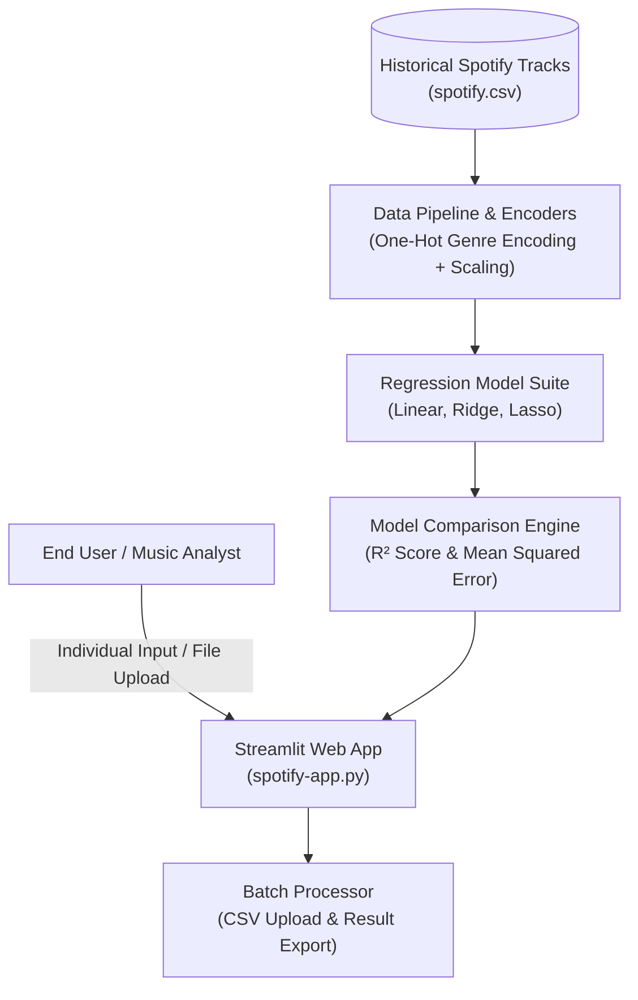

# 🎵 Spotify Song Popularity Predictor

[](https://streamlit.io/)
[](https://scikit-learn.org/)
[](https://python.org/)
[](https://spotify-app-by-narasimhamanam.streamlit.app/)

A machine learning web application that estimates the popularity score of Spotify tracks based on musical metadata (genre, track duration, and explicit lyrical flags). The platform allows users to compare regularized linear regression techniques (**Linear**, **Ridge**, and **Lasso Regression**), inspect model evaluation metrics ($R^2$ and MSE), and upload batch CSV datasets for bulk prediction.

---

## 🏗️ Architecture



---

## 🧠 Features

- **Interactive Song Scoring:** Predict popularity (0–100 scale) by customizing song genre, track duration in milliseconds, and explicit content status.
- **Model Comparison Suite:** Dynamically toggle between three regression estimators:
  - **Ordinary Least Squares (Linear Regression)**
  - **L2 Regularization (Ridge Regression)**
  - **L1 Regularization & Feature Sparsity (Lasso Regression)**
- **Diagnostic Metrics:** Real-time computation of $R^2$ score and Mean Squared Error (MSE) across models.
- **Batch CSV Ingestion:** Upload arbitrary CSV files with track features and export predicted popularity scores as downloadable CSV reports.
- **Visual Analytics:** Distribution histograms and genre popularity rankings rendered via Matplotlib and Seaborn.

---

## 📁 Dataset

The application is trained on `spotify.csv` containing track features:
- `name`: Track title
- `genre`: Primary musical genre
- `duration_ms`: Track length in milliseconds
- `explicit`: Binary indicator for explicit lyrical content
- `popularity`: Target continuous popularity index (0–100)

---

## 🛠️ Installation & Setup

### 1. Clone the Repository
```bash
git clone https://github.com/Narasimhamanam/Spotify_project_-ML-.git
cd Spotify_project_-ML-
```

### 2. Set Up Virtual Environment & Dependencies
```bash
python -m venv .venv

# On Windows:
.venv\Scripts\activate
# On macOS / Linux:
source .venv/bin/activate

pip install -r requirements.txt
```

### 3. Launch the Application
```bash
streamlit run spotify-app.py
# Runs locally at http://localhost:8501
```

---

## ⚠️ Limitations & Honest Status

- **Linear Assumption:** Popularity modeling relies on linear/regularized linear estimators. Feature non-linearities (e.g. artist notoriety, viral trends, social media momentum) are outside the scope of acoustic duration and genre attributes.
- **Static Dataset:** Model weights are fitted upon app startup from the local `spotify.csv` snapshot.
